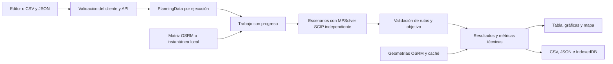

# Uso y arquitectura del estudio de distribución

AgroDistribuye 0.8.4 permite editar una jornada, ejecutar el MDVRPTW y comparar sus resultados. La implementación en Julia y la validación cruzada con otra herramienta quedan pendientes de confirmación; no se presentan como realizadas.

## Datos y límites

La interfaz se organiza en cinco pestañas: Resumen, Datos, Ejecutar, Resultados y Mapa. Datos separa demanda, inventario, depósitos, horarios y flota. Resultados separa resumen, comparación, análisis, rutas y método. Cambiar de pestaña no reinicia entradas ni escenarios. Las flechas, Inicio y Fin permiten navegar entre pestañas; los enlaces y el historial conservan la vista seleccionada. Un campo inválido abre automáticamente su tabla de entrada. El indicador de progreso permite volver al cálculo desde cualquier vista.

Los once nodos mantienen el orden C1, C2, C3, P1…P8; hay cuatro productos PR1…PR4. Las coordenadas son referencias rurales y candidatos de depósito, no predios ni accesos operativos verificados. Se pueden editar demanda, inventario, capacidad de depósitos, ventanas, duración del servicio y flota de 1 a 8 vehículos con sus costos. La alternativa que añade un vehículo requiere como máximo siete de entrada.

El horizonte es una jornada de 07:00 a 18:00; cada vehículo realiza como máximo un viaje, regresa al mismo depósito y cada productor con demanda recibe una entrega completa. Los productores con demanda cero no se visitan. Las capacidades están en toneladas, los tiempos en minutos y los costos en COP por jornada usada y COP/km. La tolerancia de la validación de capacidad es 1e-5 t. El ejemplo económico y operativo es simulado; el usuario declara el origen de sus propios datos. El costo observado de una operación real es opcional y debe tener la misma unidad y horizonte; no se inventa a partir de A_BASELINE.

## Importación y exportación

El botón Descargar datos CSV produce una plantilla completa con cinco columnas: `section;id;field;value;unit`. Usa punto decimal, horarios HH:mm y UTF-8. Ejemplos disponibles en `data/ejemplo-planificacion.csv` y `.json`.

| Sección | ID | Campo | Unidad |
|---|---|---|---|
| DEMAND | P1…P8 | PR1…PR4 | t |
| STOCK | C1…C3 | PR1…PR4 | t |
| DEPOT | C1…C3 | capacity | t |
| WINDOW | P1…P8 | start / end | HH:mm |
| SERVICE | P1…P8 | minutes | min |
| VEHICLE | V1…V8 consecutivos | capacity / fixedCost / costPerKm | t / COP / COP/km |
| META | study | provenance / actualPlanCostCop | text / COP |

La importación requiere todas las filas, sin duplicados ni unidades incompatibles. El costo observado puede quedar vacío. CSV y JSON pasan por la validación del servidor antes de reemplazar el editor. Se rechazan cantidades negativas, no finitas o ausentes, dimensiones incorrectas, inventario superior al almacenamiento y horarios sin tiempo suficiente para completar el servicio. El JSON importado puede ser un conjunto de datos, una solicitud o una ejecución exportada; en el último caso se importan sus datos de entrada, no se presentan sus resultados como una nueva optimización.

La comparación CSV incluye estado, validación, costos, objetivo, variaciones, desgloses temporales, flota, servicio, utilización, gap, cota, tamaño del modelo, parámetros y procedencia. Los escenarios sin solución validada tienen resultados económicos vacíos. El CSV de rutas contiene una fila por parada, identificada por escenario, vehículo y orden; las métricas totales de una ruta se repiten en sus paradas y no deben sumarse entre filas. El JSON conserva solicitud, matriz efectivamente utilizada, versiones, resultados y geometrías. Los CSV protegen celdas de texto que podrían interpretarse como fórmulas de hoja de cálculo.

## Escenarios y comparación

Se conservan A y las seis sensibilidades temporales B1–B3 y C1–C3. Si se activan las opciones adicionales se resuelven quince escenarios:

- A: referencia del modelo, salida fija a las 07:00 y objetivo de costo base.
- B1–B3: penalización de espera en depósito de 50, 100 y 300 COP/min, con productor en 200 COP/min y salida flexible.
- C1–C3: penalización de operación de 50, 100 y 200 COP/min, con salida flexible.
- Alternativa 1: incorporar un vehículo, incluyendo su costo fijo solo si se utiliza y su costo por distancia. Capacidad y costos son editables.
- Alternativa 2: ampliar la capacidad de todos los vehículos, incluyendo un sobrecosto fijo por vehículo usado. Por defecto +20 % y 15.000 COP adicionales por vehículo utilizado; ambos son supuestos editables, no cotizaciones.
- Sensibilidad: demanda, capacidad vehicular y costo/km al 80 % y 120 % del dato de entrada; A representa el 100 %. En demanda solo cambia la demanda; el inventario permanece constante, por lo que puede aparecer infactibilidad.

Las alternativas y sensibilidades operativas mantienen el objetivo y la salida fija de A. `totalCostCop` es el costo logístico base, con los costos de la alternativa incorporados. `objectiveValue` añade las penalizaciones del experimento y no es una factura ni una métrica comparable directamente entre coeficientes diferentes.

El ahorro de costo y operación es `(referencia - escenario) / referencia × 100`; si la referencia es cero o no está validada, el porcentaje queda sin definir. Un valor negativo es desmejora. La comparación con costo observado se calcula separadamente cuando el usuario lo declara. El total desde 07:00 suma espera en depósito y operación de cada vehículo: son minutos-vehículo, no horas transcurridas de un único turno.

A y las alternativas minimizan costo y no las esperas; sus horarios pueden variar entre soluciones de costo equivalente. No debe atribuirse una pequeña diferencia de tiempo a una mejora garantizada de la política. La utilización es carga total / capacidad total de los vehículos utilizados. En este modelo determinista con satisfacción obligatoria y sin faltantes, una solución validada satisface la demanda activa completa; los indicadores de servicio I y II se reportan como 1 bajo ese supuesto, no como estimaciones estadísticas externas.

## Estados y evidencia del solucionador

El límite por escenario es editable entre 1 y 60 segundos, con objetivo de gap relativo de 1 %. Hay hasta cuatro escenarios concurrentes y dos consultas de geometría concurrentes. Cada escenario tiene datos y MPSolver independientes; el orden del JSON es estable. Una sola ejecución de estudio ocupa el motor a la vez para evitar sobrecarga.

`OPTIMAL` se reserva para brecha relativa menor o igual a 1e-7. Si SCIP termina dentro de la tolerancia configurada con brecha positiva se comunica `FEASIBLE_NEAR_OPTIMAL`; otras soluciones factibles conservan `FEASIBLE`. `INFEASIBLE` significa infactibilidad demostrada por restricciones o una comprobación necesaria de capacidad/inventario. No encontrar una solución antes del límite no demuestra infactibilidad y se explica por separado. Un error OSRM o de red se comunica como error, no como infactibilidad.

El resultado incluye variables binarias y continuas, restricciones, cota, gap, límite, versión del solver, tiempo de resolución, Java y procesadores disponibles. La validación independiente reconstruye visitas, cargas, inventario, continuidad, horarios, retorno y objetivo desde los arcos. Aumentar el tiempo puede mejorar soluciones; no se promete igual ruta o tiempo en equipos diferentes.

## Modo sin conexión

Usar matriz vial local es la opción predeterminada. El servidor lee primero `data/matrices/matrix-cache.json`, si existe, y después la matriz OSRM de referencia incluida en `src/main/resources/offline/matrix.json`. Nunca se sustituyen distancias o duraciones por líneas rectas. La fecha y procedencia de la matriz se muestran en el resultado.

Las geometrías guardadas se cargan de los recursos y de `data/matrices/geometries-cache.json`. Si falta una secuencia, el esquema geográfico la dibuja discontinua y la identifica como esquemática, sin llamarla carretera. Leaflet, estilos, iconos, coordenadas y el esquema SVG se sirven localmente; no se solicitan teselas al seleccionar Esquema local en la pestaña Mapa. La vista del mapa se elige por separado de la matriz del cálculo; el mapa geográfico de OpenStreetMap requiere internet incluso cuando se calcula con una matriz local. En modo en línea, las consultas OSRM exitosas actualizan la caché y el mapa base usa OpenStreetMap. No se descargan masivamente teselas ni se incorpora tráfico en tiempo real.

Tras empaquetar el JAR y disponer de Java compatible, la demostración local puede iniciarse sin Maven ni internet. Los datos y resultados recientes se conservan en IndexedDB del navegador; el cálculo en curso se recupera tras recargar mientras el mismo servidor siga activo. Los trabajos del servidor son temporales, se guardan hasta tres y se pierden al reiniciar. Exportar JSON es el respaldo portátil.

## Arquitectura

Spring Boot sirve la API y HTML/CSS/JavaScript. El motor usa OR-Tools 9.12.4544 y SCIP. La geometría es visual: la matriz es la entrada del modelo. Los resultados no dependen de capturar `System.out`.

| API | Propósito |
|---|---|
| GET /api/optimizaciones/datos | Ejemplo editable predeterminado |
| POST /api/optimizaciones/datos/validar | Validar un PlanningData sin resolver |
| POST /api/optimizaciones/trabajos | Iniciar un estudio asíncrono |
| GET /api/optimizaciones/trabajos/{id} | Progreso y resultado al terminar |
| POST /api/optimizaciones/ejecutar | Ejecución síncrona compatible, con cuerpo opcional |

## Verificación y entrega académica

`mvn test` comprueba entradas, demanda cero, instancia con costo conocido, aislamiento de datos paralelo, inventario insuficiente, estudio local completo, métricas y progreso asíncrono. `node --test src/test/js/workspace.test.cjs` comprueba importación/exportación CSV, duplicados, unidades, textos entrecomillados, protección de fórmulas y ahorros no definidos.

Estas pruebas y el prototipo no sustituyen la implementación Julia/contraste ni la validación con una organización, datos observados, autorización de uso, formulación y referencias del artículo. El diagrama sirve de base para la arquitectura solicitada por la guía. Para la feria, usar el modo local, exportar una ejecución de respaldo y preparar la demostración con antelación.
